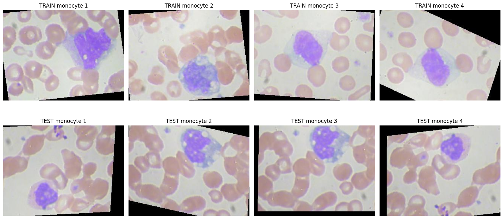
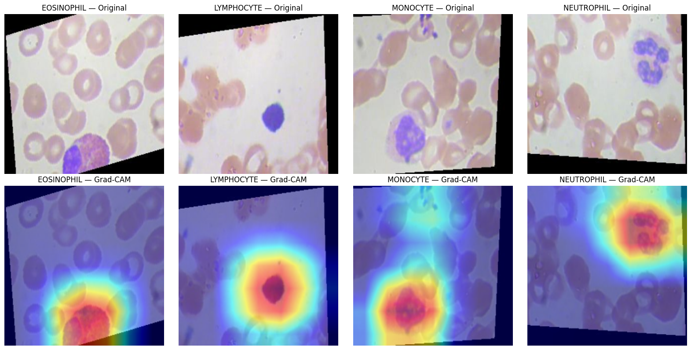

# Blood Cell Classification using CNN with Grad-CAM Interpretability

## Overview
A deep learning project that classifies white blood cells from microscopy images into 4 categories — Eosinophil, Lymphocyte, Monocyte, and Neutrophil — using a fine-tuned ResNet18 CNN. Includes Grad-CAM visualization to interpret and verify what the model focuses on when making predictions.

## Dataset
[BCCD Blood Cells Dataset](https://www.kaggle.com/datasets/paultimothymooney/blood-cells) — ~10,000 training images and ~2,500 test images across 4 balanced classes.

## Approach
1. **Baseline model** — Transfer learning with pretrained ResNet18 (frozen backbone + custom classifier head)
2. **Diagnosed overfitting** — Added a validation split to properly track generalization
3. **Diagnosed domain shift** — Found that TRAIN and TEST images differ in crop/zoom framing (visually confirmed), which was capping test performance
4. **Stronger data augmentation** — Random resized cropping, rotation, and color jitter to make the model robust to this variation
5. **Full fine-tuning** — Unfroze the entire network with a small learning rate
6. **Test-time augmentation (TTA) + model ensembling** — Averaged predictions across multiple augmented views and two trained models
7. **Grad-CAM** — Visualized model attention to confirm it focuses on the actual white blood cell, not background artifacts

**Train vs. test framing difference (domain shift):**

## Results
| Stage | Test Accuracy |
|---|---|
| Baseline (frozen backbone) | 70.12% |
| + Validation split & dropout | 74.95% |
| + Stronger augmentation | 77.20% |
| + Full fine-tuning | 77.32% |
| + TTA | 80.46% |
| + Ensemble + TTA | **81.26%** |

**Known limitation:** Neutrophil precision remains lower (~55-59%) due to visual similarity with other granulocytes under this staining protocol, and a train/test domain shift in image framing that augmentation could only partially correct. Further gains would likely require rotation-aware preprocessing or additional labeled data.

## Grad-CAM Results
Grad-CAM visualizations confirmed the model consistently focuses on the actual white blood cell (stained nucleus region) rather than surrounding red blood cells or background — validating that the model learned biologically meaningful features rather than spurious correlations.

*Top row: original test images. Bottom row: Grad-CAM heatmaps, with red showing where the model looks. In every class it focuses on the white blood cell.*

## Tech Stack
Python, PyTorch, torchvision, Grad-CAM, scikit-learn, Google Colab (T4 GPU)
